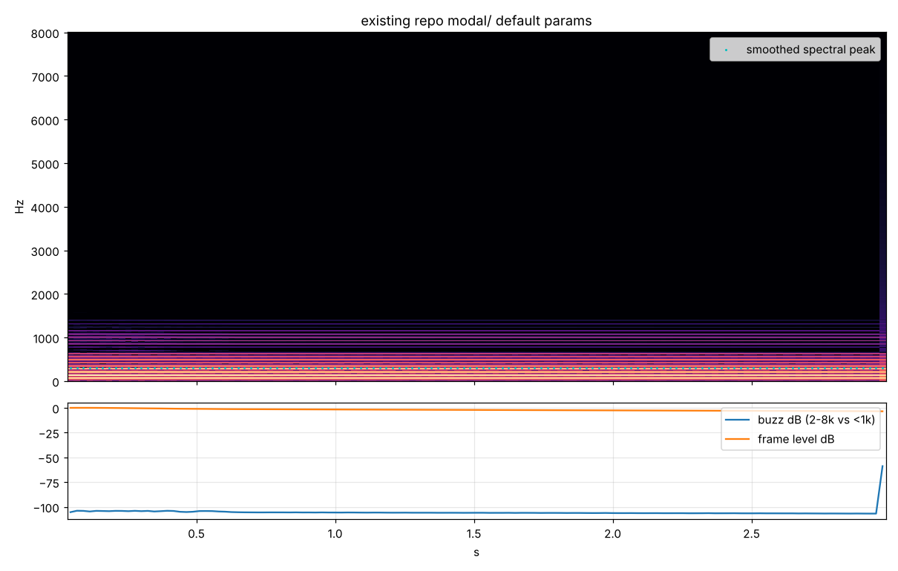
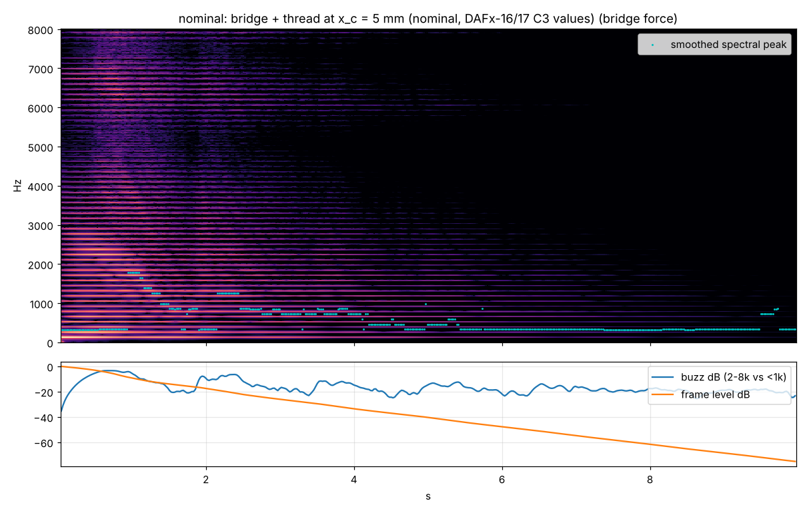
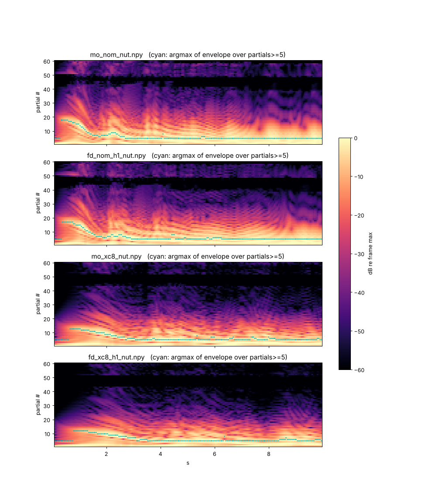

# Tanpura physical modelling: evaluation and way forward

*November 2026. Every number below comes from code that was run, with the scripts named. Nothing is estimated from memory.*

## TL;DR

| Question | Answer |
|---|---|
| **Is it still possible?** | **Yes.** It works now: [`jawari/`](../jawari/) contains a 1-D and a 2-polarisation tanpura string model that produce genuine jawari. You get a band of boosted harmonics that sweeps down from ~1.8 kHz to ~0.45 kHz over ~5 s, and buzz that stays high for ~8 s. Both are energy-stable to ~1e-11, faster than real time (1-D) or about real time (2-D), and checked against a completely independent finite-difference model. |
| **What was wrong?** | Structural, not tuning. (1) The thread and bridge geometry meant the string **never rested on the jiva**. (2) Contact was **~10⁷× too soft** and mis-scaled, so the string passed 0.4 mm *through* the bridge. (3) Each method had a fatal bug: the waveguide dies in 50 ms, the FDTD has no damping and a grid too coarse to see the thread, and the modal "tension modulation" breaks energy conservation. (4) The output was string displacement instead of bridge force. (5) An optimiser was asked to find jawari in a parameter space that contained none. |
| **Better method?** | Modal string with **exact per-mode updates**, **discrete-gradient (energy-conserving) contact solved by Newton**, a stiff physically scaled penalty (penetration in nanometres), the **string resting on the thread** with the bridge crest grazing it, **bridge-force output**, 4× oversampling. That is the van Walstijn et al. approach, re-implemented here. |
| **"No one has done this before"?** | **Not accurate.** Van Walstijn, Chatziioannou, Bridges and Mehes (QUB, 2014–2017) and Issanchou, Bilbao et al. (2016–2018) published tanpura string models, and a 2026 app (Rangiin) claims real-time physical modelling. **What is genuinely open**, and what you could be first at, is a model that reproduces **how the jawari depends on thread placement**, validated against a real instrument. Our results suggest this is governed by **micrometre-scale rest geometry**, a new and testable hypothesis (§4). |

---

## 1. What the existing code actually produces

All three synthesizers were run, with and without the bridge (`K_contact = 0`), and measured with the shared jawari metrics in [`jawari/metrics.py`](../jawari/metrics.py). *Buzz* = 10·log₁₀(E[2–8 kHz]/E[<1 kHz]); a plain string sits around −100 dB, a jawari tone around −5 to −20 dB.

| Method | Effect of the bridge (K vs K=0) | Buzz | What you actually hear |
|---|---|---|---|
| `modal/` | ~1–3.5 % waveform change, **no spectral change** | **−105 dB**, nothing above 1.5 kHz, centroid ≈ 120 Hz | a dull, sine-like plucked string |
| `fdtd/` | max difference **4.8e-7** (float noise) | −5.8 dB, but identical with K=0: it is the narrow pluck, not the bridge | a bright string that **never decays** and is **+52 cents sharp** |
| `waveguide/` | max difference **1.7e-6** | n/a: the tone is at **−84 dB after 50 ms** | a click |


*Fig. 1: the repo's `modal/` output at default settings. There is no energy above ~400 Hz, and bridge and thread change nothing.*

## 2. Root causes, ranked

Found by an independent audit and then adversarially re-checked: 13 confirmed, 5 partly confirmed, **0 refuted**.

### Critical

1. **Wrong rest geometry** (`shared/params.py:34`, `shared/bridge.py:7`).
   - The bridge surface sits **0.50 mm below** the string at the string's own termination, then falls to −1.0 mm.
   - The jiva's top is **0.245 mm below** the string, so the string never rests on it.
   - A string pinned at x=0 moves only tens of µm within the first centimetre, so it almost never reaches the bridge, and when it does it slaps through the 11–40 mm region at its extremes.
   - The physics needs the opposite. The string rests on the thread, and the bridge crest sits within **micrometres** of the string line. §4 shows that a few µm make the difference between full jawari and none.

2. **Contact ~7 orders of magnitude too soft and mis-scaled** (`modal/kernels.py:43`, `fdtd/kernels.py:49`, `waveguide/kernels.py:99`).
   - The modal projection lacks the quadrature weight Δx and 1/μ. FDTD treats force as acceleration. The waveguide injects force into *displacement* waves.
   - One shared `K_contact` therefore means a different, near-zero stiffness in each method.
   - Measured penetration: **425 µm** (modal). Holding it below 1 µm needs K ≈ 6e13 N/m³.

3. **Waveguide loss filter kills the tone** (`waveguide/synthesizer.py:33`).
   - `1 − σ₀·dt·10` is clamped to 0.999, giving a **7 Hz one-pole low-pass** inside the loop, i.e. −20 dB per round trip at f0.
   - The loop resonates at 53 Hz instead of 69 Hz.
   - The topology is also wrong (`waveguide/kernels.py:97,114`). Displacement is summed from waves at two *different* physical points, and contact is sensed half at the nut.
   - The dispersion allpass has the wrong sign and is ~10⁴× too weak.

4. **FDTD damping sign error and wrong stability bound** (`fdtd/kernels.py:57`, `fdtd/synthesizer.py:30`).
   - Damping: (1+a)u⁺ = 2u + a·u − (1+a)u⁻ has root product 1, so **σ₀ does nothing**.
   - Stability: the CFL formula isn't Bilbao's, so the grid is 8.2 mm (1.77× too coarse).
   - With that grid the 4 cm bridge gets ~5 nodes and the jiva is **missed entirely**: `jiva_pos` changes the output by 9e-10.
   - Clamped ends add +52 cents of pitch error and heavy numerical dispersion.

### Major

5. **"Tension modulation" is a non-physical heuristic** (`modal/kernels.py:59`). ω is scaled by the summed bridge penetration. With σ=0 and K=0 it **loses 17 % of the energy in 2 s**, and it causes the blow-up at `bridge_height = −0.2 mm`, which is exactly where the thread starts to touch. Real Kirchhoff–Carrier modulation depends on ∫u_x² dx.
6. **Explicit penalty Verlet** is only conditionally stable at realistic stiffness. At K≈1e13 with 4× oversampling it gains 8.7 % energy per second or diverges (160 modes).
7. **80 modes** give ~6 independent degrees of freedom across the bridge, and the 1 mm jiva is invisible to the basis.
8. **Output = string displacement at 0.9 L.** Bridge force is what drives the body. Switching outputs gains ~20 dB of buzz, but that alone would not have rescued the model.
9. **Excitation** low-passed by `exp(−(5·n·w)²)`, so nothing starts above ~1.4 kHz. The three methods each use a different pluck.
10. **The optimiser cannot fix any of it.**
    - The best point anywhere in the search space reaches −92 dB buzz.
    - In FDTD and waveguide, four of the six tuned parameters change the output by < 2e-5.
    - Optuna `n_jobs` threads run **0.4×** as fast as sequential under the GIL.
    - `except Exception: return 2000.0` hides bugs.
11. **Loss function.**
    - The "MFCC" term is not an MFCC: `librosa.feature.mfcc(S=…)` is fed a *linear*-frequency dB spectrum with no mel filterbank.
    - That term is ~90 % of the loss, and its noise floor from partial phases alone is as large as a 10-cent detune.
    - There is no f0 or onset alignment.

### Minor
`sys.path` hacks, a `modal` package name that can collide with the PyPI `modal` package, a silent pure-Python fallback if numba is missing, no tests, an unused `cmaes` dependency, the planned 2-polarisation task never built, and a README that claims energy conservation the code doesn't have.

**The meta-lesson.** The project used **black-box optimisation as a substitute for verified physics**. The search space contained no jawari at all, and no deterministic test (statics on the thread, pitch, T60, energy balance, penetration depth) existed that would have revealed it. The fix is a physics-first workflow: validate each layer before fitting anything.

## 3. What works: the `jawari/` models

### 3.1 Method (1-D, [`jawari/tanpura1d.py`](../jawari/tanpura1d.py))

After van Walstijn et al. (DAFx-16/17).

- **String:** stiff, damped, simply supported at the bridge-side termination (x=0) and at the nut. Modal expansion with **all 133 modes below 20 kHz**, using DAFx-16's C3 string (L = 1 m, f1 = 130.81 Hz).
- **Linear update:** exact-pole modal update, so frequencies and decay rates are exact and the update is unconditionally stable.
- **Thread (jiva):** at x_c = 5 mm, a stiff bilateral spring-damper. **The string rests on it.**
- **Bridge:** rigid parabola h_b = −3(x − 10 mm)², whose crest just grazes the string at rest. Contact is a distributed one-sided penalty f = k_b·[h_b − y]₊ with k_b = 1e11 N/m², sampled every 0.2 mm.
- **Contact force:** a **discrete gradient** of the contact potential (energy-conserving), solved every sample by Newton on the active points. That is 1.2–2.5 iterations on average with 0 failures.
- **Sampling and output:** 4× oversampled (176.4 kHz) and decimated to 44.1 kHz. Output is the **total vertical force on the bridge**.
- **Implementation:** the whole time loop is one `@njit` function. **0.55–0.8 s of CPU per second of audio.**

### 3.2 Validation ([`jawari/validate1d.py`](../jawari/validate1d.py))

| Test | Result |
|---|---|
| Partial frequencies, contact off | exact to 1e-5 cents (partials 1–100). This only confirms the update; the independent cross-check below is the real test. |
| Energy, lossless, contact active 41 % of samples | relative drift **4e-12**; the lossy balance closes to 4e-12 |
| Penetration | **24–93 nm**, i.e. 0.1–0.2 % of the thread lift (the old repo: 425 µm) |
| Static force scaling (judge) | deflection under load matches the analytic value at a ratio of **1.0000**; the contact force has the correct sign |
| Convergence (fs ×2; modes to 40/80/160 kHz; bridge dx; k_b ×10) | mean buzz within **0.9 dB**; the formant trajectory is unchanged. The instantaneous trajectory is chaotic and not converged; only averages are meaningful. |
| **Independent finite-difference model** ([`jawari/fdstring.py`](../jawari/fdstring.py)), no shared code, 0.5–1 mm grid | mean buzz **−12.0 dB vs −12.0 dB**; the same formant trajectory and the same partial-envelope arcs (Fig. 5) |

### 3.3 Results

From [`jawari/render1d.py`](../jawari/render1d.py); bridge force, 10 s.

| Case | buzz @ 0.5 / 1 / 2 / 4 / 8 s (dB) | Spectral peak |
|---|---|---|
| Linear string (no bridge, no thread) | −120 / −122 / −128 / −136 / −139 | fixed |
| **Bridge + thread at 5 mm (nominal)** | **−5.1 / −5.4 / −9.2 / −14.6 / −17.6** | **sweeps down: 1.8 kHz → 1.39 → 0.93 → 0.72 → 0.46 kHz** |
| Bridge, no thread | −0.8 at 0.5 s, then collapses (centroid 5.9 kHz) | harsh, short (as DAFx-16 reports) |
| Bridge + thread, **no string stiffness** | strong buzz | **stuck at 334 Hz: buzz but no jawari sweep** |


*Fig. 3: the 1-D model, bridge + thread at 5 mm. Compare with Fig. 1 and with [the linear string](figures/02_linear_string.png).*


*Fig. 5: per-partial envelopes. Top pair: the thread at 5 mm in the modal model and in the independent FD model. Bottom pair: the same for the thread at 8 mm. The descending arcs are the jawari "formant"; the two independent discretisations agree.*

**Mechanism.** The judge isolated it. The sweep is **dispersive dephasing**: it speeds up as string stiffness (inharmonicity B) grows, persists with *all losses removed*, and vanishes with EI → 0 ([Fig. 4](figures/04_no_stiffness_no_jawari.png)). The bridge supplies the broadband impulses. Stiffness makes the high partials drift out of phase at different rates, and that drift is what sweeps the band downwards. This matches Raman's 1921 "descending formant".

### 3.4 Two polarisations ([`jawari/tanpura2d.py`](../jawari/tanpura2d.py))

- **Polarisations:** a vertical one and a horizontal one, both modal.
- **Couplings:**
  - bridge friction μ(v) = 0.39·atan(2.84 v), the Vienna Talk 2015 law;
  - a rotated-axis frequency split at the nut (30°, 1 cent nominal);
  - Kirchhoff–Carrier tension modulation shared by both polarisations.
- **Energy:** the scheme is energy-consistent. The lossless drift is 3e-11. With friction on, energy only decreases, and the balance closes to 2e-11.
- **Reduction to 1-D:** it reproduces the 1-D model to 2e-9 before the chaotic contact dynamics diverge.
- **Speed:** ≈ 1.2 s of CPU per second of audio. Validation is in [`jawari/validate2d.py`](../jawari/validate2d.py).
- **Independent re-run:** every validation number, and six renders, reproduced bit-for-bit.
- **Perceptual flaw.** The bridge face is flat across the string, so the horizontal polarisation never touches it. Energy that migrates into it stops buzzing. With 1 cent of nut coupling, the late mono tone is *duller* than in 1-D: mean buzz over 4–8 s is about −30 dB, against −18 dB.
- **Before this beats 1-D perceptually** it needs transverse bridge curvature or a string groove, so that the contact normal depends on z, and a frictional (stick-slip) lateral thread.

### 3.5 The user's kharaj, finger pluck and body

[`jawari/presets.py`](../jawari/presets.py), [`jawari/body.py`](../jawari/body.py), [`jawari/render_demo.py`](../jawari/render_demo.py).

**`preset('kharaj')`**
- **String:** 0.7 mm phosphor bronze, 1.05 m, C#2 (69.4 Hz), 140 modes below 20 kHz.
- **Geometry:** rest state from statics, with the thread auto-placed so the crest just grazes; the run starts in static equilibrium.
- **Tuning:** exactly 69.4 Hz with contact off. Jawari contact then makes it +4 to +7 cents sharp.
- **Pluck:** a finger-pad pluck at **L/3 from the bridge**. It excites even modes (25 % of the energy) and nulls every 3rd harmonic, as a pluck at a third should.
- **Losses:** better-justified. T60 is 41 s at the fundamental and 4.5 s at 1 kHz, about twice the old sustain; the coefficients are still unverified.

**Thread sweep.** The jawari is present at grazing and lasts the whole 12 s render. 0.1 mm of thread movement either kills it after 8 s (gap opens by 1.6 µm) or presses the crest into permanent contact.

**Body.** `apply_body` is a one-way filter from bridge force to radiated sound, built from tumba and tabli modes plus a dense high-frequency region, with optional stereo and room.
- The `tanpura_male` preset (air mode 65 Hz, soundboard 120 Hz) keeps the kharaj's low end: energy below 100 Hz is 0.237 against 0.234 dry. It adds 300 Hz–1 kHz body colour.
- The generic preset, placed for a 131 Hz string, made the octave boom by +13 dB.
- All body values are estimates. A measured response through `apply_ir` replaces them, and `BODY.md` explains how to record one.

**Independent check.** A judge re-ran everything:
- 83 regression arrays are bit-identical, so default behaviour is unchanged;
- the statics agree with the independent solver;
- pitch, penetration (≈ 0.23 µm), the bilateral-thread validity and click-free onsets were all verified.

## 4. New finding: thread sensitivity is a micrometre-geometry effect

Published work says the 1-D model *"fails to replicate the jvari's strong dependence on the thread placement"* (Bridges & van Walstijn, VT-2015) and proposes two polarisations plus friction. We tested this.

**(a) How you move the thread matters more than the number of polarisations.** In the DAFx-17-style sweep, moving the thread keeps the bridge crest exactly grazing (gap h0 = 0), which silently *resizes* the thread. Done that way, 1-D thread dependence is moderate and mostly about timing. If instead you keep a *fixed* thread (constant 75 µm lift over the local bridge surface) and slide it along the curved bridge ([`jawari/study_thread_geometry.py`](../jawari/study_thread_geometry.py)):

| Thread shift | Crest gap | Mean buzz, 0.2 N pluck | Mean buzz, 0.05 N pluck |
|---|---|---|---|
| −0.2 mm | +6 µm (pressed) | −21.9 dB* | −8.1 dB* |
| −0.1 mm | +3 µm (pressed) | −17.1 dB* | −16.0 dB* |
| 0 | 0 (grazing) | −10.7 dB | −10.7 dB |
| +0.1 mm | −3 µm | −18.3 dB | **−65.5 dB (jawari off)** |
| +0.2 mm | −6 µm | −23.9 dB | −127.9 dB |
| +0.4 mm | −11.5 µm | −60.5 dB | −127.9 dB |

\* **Correction (statics work, §4e).** The pressed rows started from a straight string that overlapped the bridge, which releases a start-up click of about 8.6 N.

- Started from static equilibrium (`static_init=True`), the soft-pluck cases change from −8.1 dB to **−124.5 dB** and from −16.0 dB to **−52.7 dB**. The string sits in permanent contact and does not buzz; this was reproduced independently.
- The open-gap rows and the conclusion are unaffected: a few µm decide between full jawari and none.
- The statics-initialised sweep (`study_statics.py`) gives a sharp optimum at grazing, 5–15 dB per 0.05 mm of thread movement, and a 17 dB buzz range over ±0.1 mm.

**(b) Cross-check.** The independent FD model ([`jawari/study_crest_gap.py`](../jawari/study_crest_gap.py)) agrees. A 1 µm gap moves the buzz by 8–14 dB; 3 µm moves it by 6–60 dB; and the gap also makes the jawari **depend on pluck strength**. That matches how players describe an "open" or "closed" jawari and why soft and hard strokes sound different.

**(c) Two polarisations are a second-order effect next to geometry.**

*The same fixed-thread sweep in 1-D and 2-D* ([`jawari/study_thread_geometry_2d.py`](../jawari/study_thread_geometry_2d.py)). Each run starts from the computed static equilibrium; values are mean buzz over 0.3–3 s on the vertical bridge force.

| Model | x_c = 4.9 mm (gap +3 µm) | 5.0 (0) | 5.1 (−3 µm) | 5.2 (−6 µm) | Range |
|---|---|---|---|---|---|
| 1-D | −19.9 | −11.2 | −19.2 | −24.8 | 13.6 dB |
| 2-D, 1 cent nut coupling | −22.4 | −9.0 | −21.1 | −27.2 | 18.2 dB |
| 2-D, 5 cent nut coupling | −22.7 | −13.8 | −21.9 | −31.9 | 18.1 dB |

A 0.1 mm thread move costs 8–13 dB **in every variant**.

*The DAFx-17-style 3–8 mm sweep (crest kept grazing).* Here the 1-D and 2-D models differ only modestly. S_track is the across-position spread of the smoothed buzz track. The noise floor comes from 1 µm "twin" runs and varies with position (0.01–0.65 dB), so the effects are at least ~6× the floor.

| Model | S_track |
|---|---|
| 1-D | 3.76 dB |
| 2-D, 1 cent | 4.44 dB |
| 2-D, 5 cents | 4.83 dB |

The nut force, which converges better, gives 3.0–3.3 dB for 1-D and 4.2–4.5 dB for 2-D. With 5 cents, onset delays spread over seconds ([Fig. 6](figures/06_thread_sensitivity_1d_vs_2d.png), [Fig. 7](figures/07_buzz_tracks_by_thread_position.png)).

*Where the 2-D increment comes from.* It comes **entirely** from the assumed nut anisotropy plus a laterally gripping thread. Removing either gives back the 1-D result exactly, while friction and tension modulation change nothing. The mechanism:

- Only the vertical polarisation touches the bridge, and intermittent contact sharpens it by 1.0–1.7 cents relative to the horizontal one.
- The amount of sharpening depends on thread position.
- It competes with the nut split, which changes how much energy the two polarisations exchange: the coupling-induced horizontal energy share is +0.18 / +0.28 / +0.44 at 3 / 5 / 8 mm.

This is physically sensible (Weinreich-type coupling of nearly degenerate polarisations), but its strength is unmeasured. In a real tanpura the dominant coupler is probably the **soundboard-loaded bridge**, not the nut.

**(d) Why this points at statics, not polarisation.** What a thread move does to the crest gap depends entirely on what *else* fixes the string's line.

- **Model in (a)–(c):** the string is pinned at x=0. Sliding the thread tilts the string and changes the gap by µm.
- **If only the thread fixed the string's direction** (on an exact parabola): sliding a fixed-diameter thread would merely translate the geometry. The tangent point stays √(d/c) beyond the thread, so there would be no effect at all.
- **A real tanpura is neither.** The string continues past the thread, over the back of the bridge, to the tailpiece. Its rest line is set by:
  - the **non-parabolic, real bridge profile**;
  - the **finite thread diameter**;
  - the **break angle** to the tailpiece;
  - **bending-stiffness rounding** of order φ·√(EI/T), which is **tens of µm** for a few degrees.

Every one of these is far larger than the µm tolerances the sound depends on. No published model computes this rest state from statics on a *measured* bridge profile.

**Hypothesis worth testing.** The jiva's job is to set a µm-scale gap and grazing angle at the bridge crest. Thread-placement sensitivity follows from the statics of the string over a real bridge profile, and the second polarisation is a refinement, not the root cause. This is falsifiable with one instrument, a profile cast and a thread sweep.

**(e) Statics, now computed** ([`jawari/statics.py`](../jawari/statics.py), [`STATICS.md`](../jawari/STATICS.md)).

The rest state is now solved, not assumed. The solver takes a parametrised or **measured** bridge profile, a finite-diameter thread, the tail break angle, the speaking-length angle and bending stiffness. It is accurate to < 0.05 µm, and an independent analytic solver (`crosscheck_statics.py`) agrees with it to < 0.001 µm. All bridge geometry is still assumed: parabola c = 3/m, 0.2 mm thread, φ = 10°.

- **Bending stiffness lifts the string at the crest** by +91 µm (C3), +471 µm (the user's bronze kharaj) and +803 µm (steel). For the kharaj an EI = 0 rest state is meaningless: the bending length √(EI/T) = 4.3 mm is about the thread-to-crest distance.
- **The break angle behind the bridge leaks into the crest gap.** For C3, φ 5° → 10° changes the gap by about −11 µm. That is 2–4× the effect of a 0.1 mm thread move, which already costs 8–60 dB of buzz. With EI = 0 the effect disappears.
- **The string can lift off the back of the bridge** at small break angles. One thread setting can then have several grazing positions, which may explain why setting a jawari is fiddly.
- **The simple sensitivity rule fails for stiff strings.** dg/dx_c ≈ 2√(c·d_t) is off by −26…+23 % for C3 and up to +105 % for the kharaj.

**Testable prediction.** The jawari setting should depend on the break angle and string gauge as much as on thread position. A measured profile plus a thread sweep on one instrument can confirm or refute this.

## 5. Prior art: is this novel?

The most relevant published work:

- **Van Walstijn & Chatziioannou, ISMA 2014:** the first dedicated time-domain tanpura string model with distributed bridge contact and a thread.
- **Chatziioannou & van Walstijn, JSV 2015:** energy-conserving contact schemes, with a tanpura case study ([arXiv 1501.01493](https://arxiv.org/abs/1501.01493)).
- **Bridges & van Walstijn, Vienna Talk 2015:** a 2-D model with friction. *"The 1-D formulation fails to replicate the jvari's strong dependence on thread placement."*
- **Van Walstijn, Bridges & Mehes, DAFx-16:** a real-time modal tanpura ([paper](https://dafx.de/paper-archive/details/DYDzhePW7F9YEWfoZSF0dQ)); no public release found.
- **Bridges & van Walstijn, DAFx-17:** adds tension modulation and distributed bridge contact ([paper](https://dafx.de/paper-archive/details/bmEGiMK6m4jP9ohFoOWKBw)).
- **Issanchou, Bilbao, Touzé, Doaré et al.:**
  - DAFx-16 ([pdf](https://core.ac.uk/download/77046169.pdf));
  - JSV 2017, a modal string-obstacle model **validated against lab experiments**;
  - JASA 2018, non-smooth contact.
- **Van Walstijn, Chatziioannou & Bhanuprakash, JSV 2024:** refined explicit and implicit energy-stable collision schemes.
- **Bhanuprakash et al., DAFx-24:** non-iterative spline contact for real time.
- **Related instruments:** sitar, veena and biwa models, including Vyasarayani et al. 2009, Siddiq 2012, Mandal & Wahi 2015/2024 and Chauhan et al. 2023.
- **Products:**
  - Almost every tanpura app is sample-based.
  - **Rangiin (June 2026)** claims real-time physical modelling of the tanpura, but its method is unpublished.
  - moForte's Naada sitar is physically modelled.
  - Oli Larkin's open-source Faust *Tambura* is a "pseudo-physical" waveguide with a nonlinear allpass.

**Verdict.** "First physical model of the tanpura" is not available as a claim. The following appear **genuinely open**; no publication was found for any of them:

1. Reproducing the jawari's **thread-placement dependence validated against a real instrument**. This is the most defensible "first", and §4 gives a concrete mechanism to test.
2. A **measured jawari bridge profile** used in a model.
3. A **four-string** tanpura with bridge and body coupling and sympathetic interaction; all published models are single-string.
4. **Fitting** a physical tanpura model to recordings, i.e. the inverse problem with non-smooth contact.
5. **Listening-test** validation of any tanpura synthesis.
6. An **open-source, energy-stable, real-time** reference implementation. `jawari/` is most of the way there.

## 6. Recommended roadmap

### Instrument facts confirmed by the user (use these as defaults)

- **Kharaj string material: phosphor bronze** (not steel). Use phosphor-bronze properties (ρ ≈ 8800 kg/m³, E ≈ 1.1e11 Pa) for the kharaj preset; the repo's original `shared/params.py` steel values are superseded.
- **Pluck position: about 1/3 (sometimes 2/3) of the string length from the bridge toward the nut.** Default x_p = L/3 from the bridge-side termination; also offer 2L/3.
- From the repo's `shared/params.py` (the user's own measurements): speaking length 1.05 m, kharaj gauge 0.7 mm, tuned to C#2 (69.4 Hz).
- After listening to the 1-D renders, the user found them close to a real tanpura but **missing body depth**, so the body/radiation model is a priority.

1. ✅ **Done (§4e): fix the rest state from statics.** Remaining: run the thread sweep on a *measured* profile. Original step: model a finite-diameter thread on a parametrised (later measured) bridge profile, including the break angle and bending stiffness. Solve the static equilibrium and start every simulation from it. Then sweep the thread in 0.05 mm steps at several pluck strengths. Treat the crest gap h0 as an explicit, reported parameter, not a default of 0.
2. **Measure one real tanpura.** Get the bridge profile (dental-putty cast plus a flatbed scan or dial indicator), string gauges and tensions, and partial T60s from a recording. Record one string with the thread swept in ~0.25 mm steps, ideally with a cheap optical or piezo string sensor. **This dataset is the thing nobody has.**
3. **Calibrate.**
   - Fit the losses to the measured T60s. The kharaj preset's Valette coefficients and body-drain mobility are unverified.
   - Fit the gap and profile to the measured formant trajectory, i.e. the time to the plateau and the plateau frequency.
   - Use jawari-specific features (buzz track, partial-envelope formant trace) with f0 and onset alignment, not the old loss.
4. **Realism.**
   - ✅ Localised finger pluck at L/3; ✅ speaking-length tuning; ✅ the C#2 bronze kharaj; ✅ a one-way body filter (§3.5).
   - **Next:**
     - jawari-on tuning, compensating the +4–7 cent contact sharpening;
     - two-way **string–body coupling** through a modal bridge admittance, then remove the separate body-drain loss term;
     - **four strings (Pa, Sa, Sa, kharaj) on a shared bridge**, which is where much of the perceived drone depth comes from;
     - a finger–string contact model for re-plucks.
5. **2-D only after steps 1–2.**
   - Replace the ad-hoc nut split with a **2×2 anisotropic bridge/soundboard admittance**. In one step that gives the polarisation coupling, the radiated output (replacing the assumed 0.3·F_z mono weight) and the path to coupling all four strings.
   - Give the bridge transverse curvature or a groove, so the horizontal polarisation can buzz too.
   - Compare 1-D and 2-D at equal vertical excitation and identical rest geometry, using the nut force, with noise-floor twins at *every* position.
   - Measure the polarisation frequency split on a real string.
6. **Real time.** Replace Newton with the JSV-2024 explicit or DAFx-24 spline contact; that would also remove the need for 4× oversampling.
7. **Perceptual test.** Run an online MUSHRA with Indian classical musicians: model vs recording vs sample library.

## 7. Caveats

- **No primary paper PDF could be read in full.** This session's network blocks `pureadmin.qub.ac.uk`, `arxiv.org`, `viennatalk2015.mdw.ac.at` and `core.ac.uk`. Parameter values (k_c, r_c, bridge curvature, x_b, the friction law) come from search-result excerpts. The physics checks pass regardless, but "faithful to DAFx-16/17" is **unverified**.
- **Losses are untuned defaults.** The tone decays faster than a real tanpura.
- **The excitation is idealised:** a whole-string force pulse that excites odd modes only.
- **What is missing:** a body, other strings, and a measured profile.
- **Only smoothed or averaged metrics are meaningful.** The contact dynamics are chaotic, so the fine trajectory is not converged.
- **The 2-D sensitivity increment rests on an unmeasured parameter**, the nut-coupling strength. The friction law and its units (VT-2015) could not be verified; a near-Coulomb variant changes both damping and polarisation exchange substantially.
- **The bridge-force output** includes a truncated termination-shear series, which converges slowly with mode count. For sensitivity studies the nut force is the cleaner signal.
- **No independent 2-D cross-check yet:** the 2-D model has not been cross-checked against an independent 2-D implementation. Extending `fdstring.py` to two polarisations is the obvious test.

## 8. Reproduce

```bash
uv sync
cd jawari
uv run python validate1d.py          # 1-D physics tests, ~100 s
uv run python render1d.py            # 10 s renders + spectrograms -> out/1d/
uv run python validate2d.py          # 2-D physics tests, ~2 min
uv run python render2d.py --jobs 2   # thread sweep 1-D vs 2-D -> out/2d/ (~10 min)
uv run python sens2d.py              # sensitivity tables/figures
uv run python study_thread_geometry.py   # §4(a) fixed-thread sweep
uv run python study_crest_gap.py         # §4(b) modal vs independent FD
uv run python study_thread_geometry_2d.py # §4(c) fixed-thread sweep, 1-D vs 2-D (~3 min)
uv run python validate_statics.py        # §4(e) statics tests (~1 min)
uv run python render_demo.py             # §3.5 kharaj + statics + finger pluck + body -> out/demo/ (~2 min)
```
