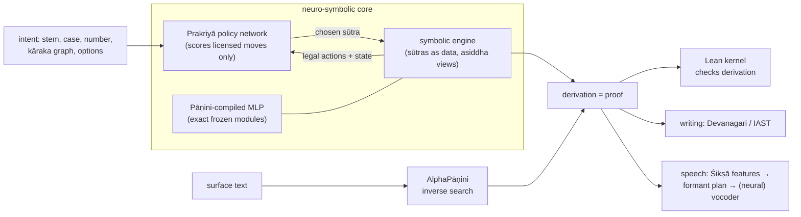

# The Aṣṭādhyāyī as a machine: a research program for deterministic Sanskrit

> **Question.** Can Pāṇini's Aṣṭādhyāyī be encoded in Lean, or in a new kind of
> neural network, so that Sanskrit can be written, spoken and analysed
> *deterministically*? What would move this field forward?
>
> **Short answer.** Yes to both, and the two are best built *together*: Lean as
> the ground truth that certifies derivations and proves facts about the
> grammar, and neural networks that either **are** the grammar (compiled
> exactly into their weights) or only ever **choose among** moves the grammar
> licenses. This branch contains working prototypes of each piece. §3 and §4
> describe what to build next.

---

## 1. Why the Aṣṭādhyāyī is an ideal formalization target

Pāṇini's grammar (c. 4th century BCE) is a generative system of roughly 4,000
*sūtras* in 8 books (*adhyāya*) × 4 quarters (*pāda*). It comes with auxiliary
inventories: the 14 Śiva-sūtras (sound classes), the Dhātupāṭha (~2,000 verbal
roots), the Gaṇapāṭha (lists of words), and others. It is written in a
metalanguage with explicit technical devices that map almost one-to-one onto
modern computing concepts:

| Pāṇinian device | What it does | Computational analogue |
|---|---|---|
| Śiva-sūtras + **pratyāhāra** (1.1.71) | name a sound class by its first member + a marker | interval encoding of sets on a fixed linear order |
| **it**-markers / anubandha (1.3.2–9) | letters attached to morphemes that are deleted but trigger rules (*k-it* blocks guṇa, 1.1.5) | type tags / metadata bits on tokens |
| **anuvṛtti** | words of a sūtra silently carry over into the following sūtras | implicit arguments, lexical scoping, ellipsis resolution |
| **adhikāra** | a heading that governs a block of rules (e.g. 6.1.72 *saṃhitāyām*) | scoped blocks / namespaces |
| **paribhāṣā** | metarules on how to read and apply rules | interpreter semantics |
| **utsarga / apavāda** | general rule vs. exception | specificity ordering / pattern-match priority |
| **1.4.2 vipratiṣedhe paraṃ kāryam** | in a conflict, the *para* rule wins | conflict-resolution strategy (its meaning is disputed; see §3.3) |
| **8.2.1 pūrvatrāsiddham** | the last 3 quarters (*tripādī*) apply in strict order and are invisible to earlier rules | staged compilation; a pass whose writes earlier passes cannot read |
| **1.1.56 sthānivad ādeśo 'nalvidhau** | a substitute inherits the properties of what it replaces | proxy / inheritance |
| **1.1.62 pratyayalope pratyayalakṣaṇam** | a deleted suffix still conditions operations | tombstones / ghost nodes |
| **vā, vibhāṣā, anyatarasyām** | optional rules | nondeterminism, made explicit as a choice vector |
| **vivakṣā** (speaker's intent), **kāraka** (1.4.23–55) | derivation starts from meaning: participants, tense, number… | a typed semantic input graph |
| **1.1.50 sthāne 'ntaratamaḥ** | the substitute is the "nearest" candidate | nearest neighbour in articulatory feature space |

### What "deterministic" can honestly mean

The grammar is **not** a function from meaning to sound. It contains hundreds of
optional rules, and several surface forms are often equally correct: *hara
iha* and *harayiha*, *rāmaḥ karoti* and *rāmaẖ karoti*. The precise claim
this project makes, and that the engine implements, is:

> **A derivation is a pure function of (input intent, option vector).** Every
> output comes with the sūtra sequence that licenses it, and the set of all
> outputs is exactly the set of option vectors.

That gives three deterministic operations: **generate** (intent + options →
form), **enumerate** (intent → all forms) and **verify** (form + derivation →
accept/reject). Verification is the one Lean makes bulletproof.

---

## 2. State of the art (what to build on, not reinvent)

* **Vidyut / vidyut-prakriya** (Arun Prasad, Ambuda). A Rust derivation engine
  implementing 2,000+ sūtras with full prakriyās for subantas, tiṅantas,
  kṛdantas and taddhitāntas. It powers ashtadhyayi.com. It is the natural
  gold-standard generator for training data and cross-checking.
* **Sanskrit Heritage Platform** (Gérard Huet, INRIA). Finite-state
  segmentation and lemmatisation, including sandhi splitting.
* **Saṃsādhanī** (Amba Kulkarni, University of Hyderabad). Kāraka-based parsing
  and analysis.
* **Digital Corpus of Sanskrit (DCS)** (Oliver Hellwig). A large annotated
  corpus. **ByT5-Sanskrit** (Nehrdich, Hellwig & Keutzer, EMNLP Findings 2024)
  is the strongest neural analyser: segmentation, lemmatisation and
  morphosyntax from bytes.
* **Theory:** Kiparsky, *On the Architecture of Pāṇini's Grammar* (2009);
  Scharf, *Modeling Pāṇinian Grammar* (2009); Petersen, *A Mathematical
  Analysis of Pāṇini's Śivasūtras* (JoLLI 13, 2004), which proves the
  Śiva-sūtra ordering optimal; Rajpopat, *In Pāṇini We Trust* (PhD,
  Cambridge 2022), which reinterprets 1.4.2; Banerjee & Varshney, *A Pāṇinian
  Foundation for Indic Language Processing* (arXiv 2606.24172, 2026).

**The gap.** We found no machine-checked (Lean/Coq/Agda) formalization of the
Aṣṭādhyāyī, no neural architecture whose weights provably implement Pāṇinian
rules, and no neuro-symbolic system that is grammatical *by construction*.
Those are the three contributions this program targets.

---

## 3. Encoding the Aṣṭādhyāyī in Lean 4

### 3.1 What is already proved (`lean/`, no `sorry`, no `native_decide`)

| Theorem | File | Meaning |
|---|---|---|
| `pratyahara_is_interval` | Shivasutra | **1.1.71 in general**: for *every* start sound, marker and marker occurrence, the pratyāhāra is a contiguous block of the Śiva-sūtra sequence. |
| `ac_hal_partition`, `h_only_duplicate`, `aR_ambiguous` | Shivasutra | vowels/consonants partition the sounds; *h* is the only repeated sound; *aṇ* has exactly two readings. |
| `h_must_repeat` + `restrictions` | Minimality | For four classes Pāṇini uses (haś, jhal, śal, and aṇ from 1.1.69), **no** ordering listing each sound once makes all four intervals. Repeating *h* is forced (a mechanised fragment of Petersen's optimality result). |
| `savarna_refl/symm/trans` | Samjna | 1.1.9 savarṇa (with 1.1.10 and the ṛ/ḷ vārttika) is an equivalence relation. |
| `guna_derived`, `vrddhi_derived`, `ekadesa_derived` | Samjna | Guṇa/vṛddhi tables and the single substitutes a+i→e, a+ṛ→ar, a+o→au are **derived** from one definition of 1.1.50 *sthāne 'ntaratamaḥ* over places of articulation, not tabulated. |
| `conflict_free` | Sandhi | For all 14×14 vowel pairs, once exceptions block their general rules, **exactly one** of 6.1.77/78/87/88/101 remains. 1.4.2 is never needed in this fragment. |
| `hiatus_free` | Sandhi | Vowel sandhi never leaves two vowels in contact. |
| `asiddha_hare_iha`, `naive_overgenerates` | Asiddha | With 8.2.1 the grammar yields exactly *harayiha* / *hara iha*. A naive rewrite system in which earlier rules see tripādī output also yields the ungrammatical \*hareha. The metarule is *necessary*. |

Build: `cd lean && lake build` (Lean 4.22, no Mathlib, about 10 s).

### 3.2 How to scale it: a sūtra DSL

Hand-writing 4,000 rules in Lean is not the way. The plan is:

1. **Sūtra IR.** A small typed language in which each sūtra is *data*: a
   sthānin (what is replaced, as a pratyāhāra or morpheme class), a left and
   right context, an ādeśa (substitute), an adhikāra scope, apavāda links and
   an option flag. The Python engine already uses exactly this shape
   (`python/panini/sutras.py`), and Lean's `Rule` structure mirrors it.
2. **One interpreter, proved correct once.** An interpreter for the IR with
   apavāda / antaraṅga / nitya / para resolution and view-based asiddha
   (§3.4). Properties are proved about the interpreter; individual sūtras
   are checked by `decide` on their finite domains.
3. **Differential testing against Vidyut.** Every IR rule is run on
   Vidyut-generated prakriyās; any disagreement is either a bug or a
   documented divergence of interpretation.

### 3.3 Theorem targets that would be genuinely new

* **T1 — Full Śiva-sūtra optimality.** Mechanise Petersen (2004) for all ~42
  pratyāhāras. Brute force over 42! orderings is impossible, so encode "an
  ordering exists with no repeated sound in which all classes are intervals"
  as SAT, and check the UNSAT certificate inside Lean (Lean's `bv_decide`
  infrastructure already checks LRAT proofs). Then prove that repeating only
  *h* suffices.
* **T2 — The conflict map of the Aṣṭādhyāyī.** Generalise `conflict_free`: for
  each fragment, compute and *prove* the exact set of residual conflicts that
  remain after apavāda. That set is precisely where 1.4.2 and its commentarial
  patches are needed. Nobody has this list in machine-checked form.
* **T3 — Adjudicating 1.4.2.** Rajpopat (2022) argues that *para* means "the
  operation on the right-hand operand", not "the later sūtra". The engine
  already runs both readings (`--resolver sutra-order | right-operand |
  classical`): *rāma + bhis* gives \*rāmebhiḥ under naive sūtra order and
  *rāmaiḥ* under Rajpopat's reading. The classical reading needs a
  *pūrvavipratiṣedha* exception to reach *rāmaiḥ*. At full scale this becomes
  a **measurable** question: over every attested form, how many exceptions
  does each reading need? Lean can certify every counterexample.
* **T4 — Termination and confluence.** Prove prakriyā terminates (a
  well-founded measure on derivation states), and find the critical pairs of
  the non-tripādī rules (Knuth–Bendix style). Confluent fragments need no
  conflict resolution at all.
* **T5 — The semantics of asiddha.** Prove that the engine's *visibility-view*
  semantics (§3.4) equals the "ordered pass" reading on the tripādī. Then
  characterise exactly which earlier rules must see which tripādī outputs
  (6.1.113/114 see *ru* from 8.2.66; 6.3.111 sees the r-deletion of 8.3.14).
  The tradition justifies these by *vacana-sāmarthya*; the proof would make
  that list explicit and complete.
* **T6 — Certified analysis.** Define `Derives : Intent → Surface → Prop`
  inductively, one constructor per sūtra. A parser (§4.3) returns a proof
  term, and `parse_sound : parse s = some d → Derives d.intent s` makes every
  morphological analysis machine-checked.
* **T7 — Regularity of the tripādī.** Ordered rules that do not re-apply to
  their own output are regular relations (Kaplan & Kay 1994). Prove it for
  the tripādī and extract a *verified* finite-state transducer for sandhi
  splitting.
* **T8 — Autoformalization.** Use an LLM plus the anuvṛtti model (§4.4) to
  translate sūtra + Kāśikā vṛtti into the DSL. The Lean kernel and the Vidyut
  test corpus act as judges, as in autoformalization for mathematics.

### 3.4 One design idea worth highlighting: asiddha as *visibility*

Most implementations treat 8.2.1 as control flow ("run the tripādī last, in
order"). That breaks on rules like 6.1.114 *haśi ca*, which must see the *ru*
created by the tripādī rule 8.2.66. This engine treats asiddha as **data
visibility** instead:

- Every tripādī edit is appended to the segment's history.
- Each earlier rule reads segments through a *view* that hides the edits it
  may not see. Rules that name a tripādī output declare it (`sees={"8.2.66"}`).
- After each tripādī step, the earlier rules are simply re-run. Rules that
  can't see the change stay silent; rules that can, fire.

This reproduces *rāmo gacchati*, *rāmo 'tra*, *harī ramate*, *hara iha* and
*devā atra* with no special cases. The ablation (`asiddha=False`) produces the
classic errors: \*hareha, \*devātra, and \*rāmā gacchati, where 7.3.102 *supi
ca* wrongly sees the *r* of *ru* as a *yañ* sound.

---

## 4. Encoding the Aṣṭādhyāyī in neural networks



### 4.1 Pāṇini-compiled networks (built: `panini/neural/compiled.py`)

**Idea.** Put every sound on a line in Śiva-sūtra order. Because every
pratyāhāra is an interval (the Lean theorem above), testing membership costs a
**constant** number of ReLU units, however many sounds the class has:

```
[lo ≤ p ≤ hi] = step(p−lo) − step(p−hi−1),   step(z) = ReLU(z+1) − ReLU(z)
```

The rest of the compilation:

- A sūtra becomes an AND of such tests (one more ReLU).
- An **apavāda becomes an inhibitory connection** from the exception's unit
  to the general rule's unit.
- The substitute becomes a gated table lookup.

The tables themselves are generated by the symbolic 1.1.50 code, not written
by hand.

**Result.** Vowel sandhi (6.1.77/78/87/88/101) compiles to a plain 6-layer
ReLU MLP (widths 6-43-25-37-37-57-35, **506 non-zero weights**). It agrees
with the symbolic engine on **196/196** vowel pairs. It loads into any deep
learning framework, and can be used frozen as a guaranteed-correct module or
as an interpretable initialisation.

**Why the Śiva-sūtras matter to a network.** Testing all 42 pratyāhāras on a
scalar axis costs **168** threshold units in Pāṇini's order. Random orders
cost **~1,093** on average, and the best of 200 random orders still costs
852. Pāṇini's list is, in modern terms, a near-optimal 1-D embedding for
threshold networks.

**Next.**
- Compile the tripādī into a transformer via RASP/Tracr. The saṃhitā window
  maps to attention on neighbours, and the ordered rules map to layers, so the
  depth of the network is the depth of the rule ordering.
- **Grammar-preserving fine-tuning**: train a larger model while penalising
  divergence from the compiled sub-circuits, so it can learn style without
  unlearning grammar.

### 4.2 The Prakriyā policy network (interface built: `panini/neural/env.py`)

A gym-style environment in which the observation is a derivation in progress
and the **action space is exactly the set of sūtra applications the grammar
licenses** at that step. The architecture:

- **Encoder** over the derivation state (segments with tags, pada boundaries,
  adhikāra context).
- **Sūtra embedding table**, learned from each sūtra's text, number,
  adhikāra and anuvṛtti.
- **Score** = compatibility(site encoding, sūtra embedding), with a
  **masked softmax** over licensed actions only.

Properties:

* **100% grammatical by construction.** The network cannot invent a move; it
  only chooses among Pāṇini's.
* **What it learns** is exactly what the grammar leaves open: conflict
  resolution (vipratiṣedha, nitya, antaraṅga), options (style, period,
  region), and vivakṣā (what to express).
* **A falsifiable experiment.** Train on attested forms with the resolver
  hidden, then inspect which features the policy uses. Does it learn "later
  sūtra wins" or "right-hand operand wins"? The environment already exposes
  `sutra_rank`, `operand_position`, `internal` and `ekadesa`. For
  *rāma+bhis* the licensed branches are exactly {*rāmaiḥ*, *rāmebhiḥ*}, and
  the two resolvers pick different ones.

Training data: Vidyut prakriyās (imitation), then DCS attestations
(REINFORCE / preference optimisation against the corpus).

### 4.3 AlphaPāṇini: analysis as proof search

Analysis is the hard direction: sandhi-split and derive a surface form back
to stems, endings and intent. Frame it the way AlphaProof frames mathematics:

- The goal is `∃ d, Derives d surface`.
- A policy network proposes *inverse* sūtra applications.
- A value network estimates distance to a lexicon root or stem.
- MCTS searches, and the Lean kernel (or the fast engine) verifies.

Every analysis is then **certified**, unlike seq2seq analysers that can emit
impossible splits. Benchmark against ByT5-Sanskrit on DCS for segmentation
accuracy, and report the fraction of outputs carrying a checked derivation.

### 4.4 The anuvṛtti transformer: machine-readable sūtras

Sūtras are elliptical. *iko yaṇ aci* ("of ik, yaṇ, before ac") is complete
only once the words it inherits are restored (*saṃhitāyām* from the
6.1.72 adhikāra, and so on). A transformer over the sequence of sūtras, with
an **attention mask equal to the adhikāra/anuvṛtti scopes**, predicts which
words each sūtra inherits. Supervision comes from the Kāśikā vṛtti, which
spells the inherited words out. Its output is the *fully expanded* sūtra in
the IR of §3.2. That turns the whole Aṣṭādhyāyī into data for the Lean and
Python engines (target T8). The model's inductive bias is the grammar's own
scoping mechanism.

### 4.5 Grammar-constrained writing with LLMs

To have an LLM write Sanskrit that is **guaranteed** correct, decode under a
token mask produced by the generator:
- a finite-state sandhi transducer (T7), and
- the licensed-form lexicon from the derivation engine.

The LLM proposes and Pāṇini disposes. The same trick adds **metre**:
Piṅgala's chandas patterns are regular languages over laghu/guru syllables,
and syllable weight follows from 1.2.27 plus the conjunct rules. The product
automaton gives *deterministic metrical composition*: grammatical and metrical
by construction.

### 4.6 From meaning: kāraka graphs to form

Input is a kāraka graph (kartṛ, karman, karaṇa… from 1.4.23–55) plus tense and
mood. A small GNN chooses among the *vivakṣā* options the grammar permits
(passive or active, which kāraka to foreground). The deterministic engine
then produces the sentence. This is semantics-to-surface generation with a
correctness guarantee on the surface side.

### 4.7 Speaking (prototype built: `panini/speech/`)

Every parameter of the prototype is derived from the grammar:
- durations from **1.2.27** (1, 2 or 3 mātrās);
- pitch from **1.2.29–32** (udātta high, anudātta low, svarita a combination
  whose first half-mātrā is high);
- spectra from the **sthāna/prayatna** table. *e* is literally the blend of
  *a* (throat) and *i* (palate). *ai* has the same places but is
  *vivṛtatara*, rendered as a glide.

The output is bit-for-bit reproducible. It is intelligible-but-robotic formant
synthesis. The research step is a **neural vocoder conditioned on this
deterministic plan**, trained on Vedic recitation, where accent is preserved.
That keeps the linguistic content deterministic and certified, and learns
only the voice. The inverse direction is also possible: **grammar-constrained
ASR**, where the decoder's lattice is intersected with the licensed-form
automaton.

---

## 5. Data and evaluation

| Resource | Use |
|---|---|
| Vidyut prakriyās (ashtadhyayi.com) | gold derivations for imitation learning and differential testing |
| Siddhānta-Kaumudī / Kāśikā | sūtra order, vṛtti text for anuvṛtti supervision |
| Digital Corpus of Sanskrit | attested forms for RL and for adjudicating resolvers |
| Sanskrit Heritage / Saṃsādhanī | baselines for segmentation and kāraka analysis |
| Vedic recitation audio | vocoder training with preserved svara |

Proposed metrics:
- **form accuracy**;
- **derivation accuracy** (edit distance between sūtra sequences, vs. SK/Vidyut);
- **coverage** (number of sūtras implemented);
- **certified fraction** (share of analyses with a Lean-checked derivation);
- **conflict-map size** (the number of residual conflicts, T2);
- **exceptions needed per resolver** (T3).

---

## 6. Roadmap

| Phase | Deliverable |
|---|---|
| **0 (this branch)** | Śiva-sūtras, saṃjñās, 1.1.50, vowel and visarga/consonant sandhi, a-stem endings, three 1.4.2 resolvers, asiddha views, 30 Lean theorems, compiled MLP, policy environment, speech prototype |
| 1 | Sūtra IR + interpreter in Lean; complete sandhi (ṇatva, ṣatva, 8.3.7ff, 8.4.58ff, pragṛhya); all subanta paradigms; differential testing vs Vidyut |
| 2 | Tiṅanta (lakāras, vikaraṇas), kṛt, taddhita; the conflict map (T2); resolver adjudication on DCS (T3) |
| 3 | Anuvṛtti transformer + autoformalization (T8); policy network trained on Vidyut + DCS; AlphaPāṇini with certified output |
| 4 | Constrained LLM writing with metre; kāraka-to-sentence generation; vocoder and grammar-constrained ASR |

---

## 7. Honest limits of the prototype

* **Coverage is small by design.** Implemented: 32 operational sūtras plus the
  saṃjñās and metarules they rely on. Not yet implemented:
  - verbs (tiṅanta), kṛt and taddhita suffixes, compounds as a process;
  - ṇatva and ṣatva;
  - pada-final *n* before consonants (8.3.7 ff.);
  - pragṛhya (1.1.11) for finished input words.

  Junctions outside the fragment raise a warning instead of producing a guess.
* **Nominal derivation is limited** to masculine a-stems. For other stem
  classes some required sūtras are missing (e.g. 7.3.109 *jasi ca*), so those
  stems are refused rather than derived wrongly.
* **Modelling choices** are documented where the tradition offers
  alternatives:
  - the ūṣmans are classed *īṣadvivṛta*, with 1.1.10 enforced explicitly
    either way;
  - ai/au are *vivṛtatara*;
  - the tie-break inside 1.1.50;
  - the classical resolver's pūrvavipratiṣedha table has only the one pair
    this fragment exercises.
* The Lean fragment formalises vowel sandhi and the asiddha example as
  **separate models** that mirror the Python engine. Proving the two
  equivalent is part of Phase 1.

---

## References

* P. Kiparsky. *On the Architecture of Pāṇini's Grammar.* In Sanskrit Computational Linguistics, LNCS 5402, 2009.
* P. Scharf. *Modeling Pāṇinian Grammar.* Same volume, 2009.
* W. Petersen. *A Mathematical Analysis of Pāṇini's Śivasūtras.* Journal of Logic, Language and Information 13(4):471–489, 2004.
* R. Rajpopat. *In Pāṇini We Trust: Discovering the Algorithm for Rule Conflict Resolution in the Aṣṭādhyāyī.* PhD thesis, University of Cambridge, 2022.
* A. Prasad. *A fast prakriyā generator* (vidyut-prakriya). ISCLS 2024. https://github.com/ambuda-org/vidyut
* S. Nehrdich, O. Hellwig, K. Keutzer. *One Model is All You Need: ByT5-Sanskrit, a Unified Model for Sanskrit NLP Tasks.* Findings of EMNLP 2024.
* R. Banerjee, L. R. Varshney. *A Pāṇinian Foundation for Indic Language Processing.* arXiv:2606.24172, 2026.
* G. Huet. The Sanskrit Heritage Platform. https://sanskrit.inria.fr
* A. Kulkarni. Saṃsādhanī. https://sanskrit.uohyd.ac.in/scl
* R. Kaplan, M. Kay. *Regular Models of Phonological Rule Systems.* Computational Linguistics 20(3), 1994.
* G. Weiss, Y. Goldberg, E. Yahav. *Thinking Like Transformers* (RASP). ICML 2021.
* D. Lindner et al. *Tracr: Compiled Transformers as a Laboratory for Interpretability.* NeurIPS 2023.
